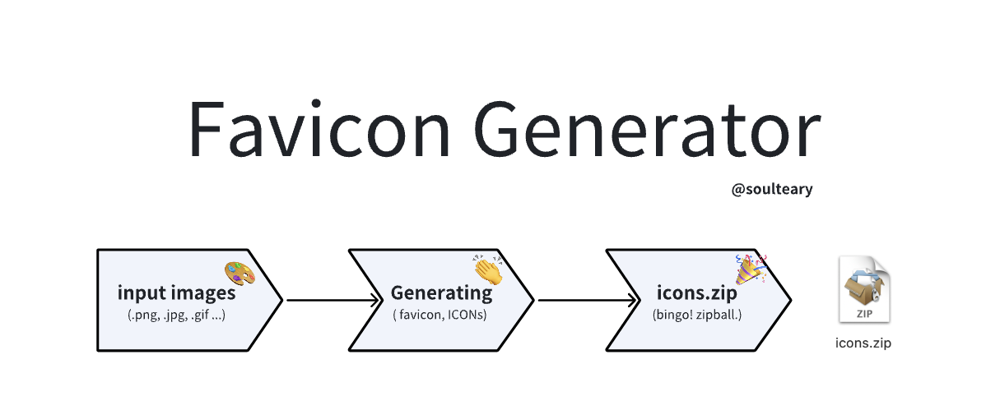

# Favicon Generator / 图标生成器

Favicon.ico &amp; App Icon Generator.

网站图标，应用图标生成器。



## Run

Requires Go 1.27.3 or later. Use the latest patch release of a supported Go
version for production builds.

```sh
go run . -cache memory:100:1h
```

The public listener serves the preview interface at
<http://localhost:8080/>; a separate management listener uses `localhost:9090`.
Existing imageproxy requests also accept optional transforms in the path, for
example:

```text
http://localhost:8080/32x32,png/https://example.com/logo.png
```

Download a complete icon package from one source image:

```sh
curl --get 'http://localhost:8080/icons/icons.zip' \
  --data-urlencode 'url=https://example.com/logo.png' \
  --data-urlencode 'name=Example App' \
  --data-urlencode 'shortName=Example' \
  --output icons.zip
```

Print build information without starting either listener:

```sh
go run . -version
```

Normal development builds report `dev`. Release builds can set the fields used
by version-kit:

```sh
go build -ldflags '-X github.com/soulteary/version-kit/v4.Version=1.0.0 -X github.com/soulteary/version-kit/v4.Commit=COMMIT -X github.com/soulteary/version-kit/v4.BuildDate=BUILD_DATE' -o favicon-generator .
```

## Browser preview

Open the public root page in a browser with JavaScript enabled, paste an
absolute HTTP(S) image URL and select **生成预览**. The page displays the six PNG
sizes described below, fetching one preview at a time through the existing
same-origin icon API. The browser never loads the remote source image directly.

Under **高级设置**, optionally set the application name and short name used by
the manifest. If the service requires signed sources, paste an existing
URL-safe HMAC-SHA256 signature into **来源签名**. This field accepts the `s`
signature described below; never enter the server's `signatureKey`.

After all six previews succeed, select **下载图标包** to request `icons.zip`.
Previewing does not generate a ZIP automatically. Editing any input, submitting
again, selecting **取消**, or leaving the page cancels the previous work and
releases its preview/download object URLs. Late responses cannot replace newer
previews; changed inputs require another successful preview before downloading.

Input errors and API failures appear as short Chinese messages for invalid
parameters, blocked sources or signatures, resource limits, busy service and
timeouts. Raw upstream error bodies are not displayed. The server continues to
enforce origin, signature, concurrency and image-budget checks for every request.

The application does not save source URLs or signatures to local storage,
session storage or cookies, and does not add them to the page address. They
remain in the current form and are sent as query parameters to the same-origin
API when generating or downloading. UI and asset responses use `no-store` and
`no-referrer`; previews use temporary blob URLs. The HTML, JavaScript and CSS are
embedded in the Go executable, with no external scripts, fonts or image requests.
No frontend build step or Node.js runtime is needed to run the service.

## Icon downloads

The public listener provides `GET` and `HEAD` downloads under `/icons/`:

- `favicon.ico`: one ICO containing 16, 32, 48 and 256 pixel images, using
  PNG-compressed 32-bit RGBA frames.
- `favicon-16x16.png`, `favicon-32x32.png`, `favicon-48x48.png`: square PNG favicons.
- `apple-touch-icon.png`: a 180 pixel PNG.
- `android-chrome-192x192.png`, `android-chrome-512x512.png`: app icon PNGs.
- `site.webmanifest`: JSON manifest with 192 and 512 pixel icon references.
- `icons.zip`: all eight files above, with a manifest suitable for deployment.

Every endpoint requires a `url` query parameter containing an absolute HTTP(S)
source URL. Encode the parameter with `--data-urlencode` or a URL query builder
so source query strings are preserved. When signature keys are configured, add
`s` containing the URL-safe base64 HMAC-SHA256 of the original source URL,
without transform options. The signature and allowlist checks also apply to
manifest requests. Existing imageproxy paths and their signature syntax continue
to work.

Only ZIP and manifest requests accept optional `name` and `shortName`
parameters, both defaulting to `App`. They must be nonblank UTF-8 strings of at
most 128 and 32 characters respectively, without control characters. Unknown or
repeated parameters and oversized queries return `400`. Filenames and output
sizes are fixed.

Images retain their proportions and are centered on a transparent square. Small
sources are enlarged to produce the exact requested dimensions, independently
of the proxy's `-scaleUp` option. JPEG/TIFF orientation is applied. Animated GIFs
use the first frame after checking the complete source's frame and pixel
budgets. Each download retrieves the source once and derives the requested sizes
from one normalized image.

The standalone manifest links back to the generator's PNG endpoints, preserving
the source URL and signature in those links. The ZIP manifest uses relative
filenames and retains no source URL or signature; extract all files into the
same directory on your website. Both manifests declare icon purpose `any` and
display mode `standalone`; configure your application's `start_url`, scope and
other metadata when deploying. For files deployed at the website root:

```html
<link rel="icon" href="/favicon.ico" sizes="any">
<link rel="icon" type="image/png" href="/favicon-32x32.png" sizes="32x32">
<link rel="apple-touch-icon" href="/apple-touch-icon.png">
<link rel="manifest" href="/site.webmanifest">
```

Downloads use `private, no-store` responses because their source URLs or manifest
links can contain credentials. `HEAD` validates and generates the same artifact
as `GET`, returns its headers and omits the body. ZIP downloads have a fixed
`icons.zip` attachment filename. No files are written to disk.

## Configuration

Explicit command-line flags take precedence over their `IMAGEPROXY_`
environment variables; unset values use defaults. Environment names use the
uppercase flag name without added separators, for example
`IMAGEPROXY_ADMINADDR`, `IMAGEPROXY_SHUTDOWNTIMEOUT` and `IMAGEPROXY_LOGLEVEL`.
An explicitly empty value is applied, so `-adminAddr=''` or an empty
`IMAGEPROXY_ADMINADDR` disables the management listener. CLI cache flags replace
the environment's cache configuration rather than adding tiers to it.

Malformed flags, positional arguments, invalid environment values, unsupported
log levels, invalid listener/base URL/allowlist syntax and unsafe resource
limits fail startup. Configuration errors omit input values, including credentials.
An invalid lower-priority environment value is ignored when that option was
explicitly supplied on the command line. `-version` does not consult unrelated
environment settings or start the service.

Caching is disabled unless configured. `-cache memory` selects 100 MB;
`-cache memory:100:1h` sets a capacity of 100,000,000 bytes and a one-hour age.
Repeat `-cache` for additional memory tiers, or put space-separated tiers in
`IMAGEPROXY_CACHE`. Capacities must be positive integer MB values without
overflow. An omitted or zero age disables expiration; positive fractional
seconds are rounded up to whole seconds. Unsupported backends, negative ages
and malformed cache specifications are rejected.

Run `go run . -h` for all options and their environment names.

## Health, metrics and logs

The public listener accepts `GET` and `HEAD` on these health routes:

- `/health-check`: the compatible plain-text `OK` liveness response.
- `/livez`: a JSON liveness response.
- `/readyz`: a JSON readiness response; returns `503` until startup completes
  and when shutdown begins.

Readiness becomes healthy only after every configured listener has bound. It
reflects the service lifecycle, rather than fetching an external image. The
management listener serves `/metrics`, `/livez` and `/readyz`; `/metrics` is
unavailable on the public listener. Keep the management listener on a trusted
network if changing its default loopback address. It has no application-level
authentication and no runtime log-level mutation endpoint.

```sh
curl http://localhost:8080/readyz
curl http://localhost:9090/metrics
```

Prometheus metrics use a service-owned registry with the
`favicon_generator_http_` prefix. They include request counts, latency, in-flight
requests and request/response sizes. Labels use fixed route names, bounded HTTP
method categories and response status codes; source URLs, query values and
signatures are never label values. Scraping `/metrics` does not record another
HTTP observation.

Pipeline timing and cache counters use the `favicon_generator_pipeline_`
prefix. Fixed pipeline, stage, result and cache-layer labels describe image and
icon work without recording source URLs or signatures. See
[pipeline metrics](docs/metrics.md) for stage boundaries and cache outcomes.

Logs are structured JSON written to standard error. `-logLevel info` is the
default; successful access events require `debug` or `trace`, while HTTP errors
are logged at `warn`. `-verbose` promotes `info` to `debug`; other selected log
levels are retained.
Request logs contain only a fixed route, method, status and duration. Internal
proxy and HTTP-server diagnostic text is omitted because it can contain source
URLs, signatures or panic values.

## Shutdown

`SIGINT` and `SIGTERM` first clear readiness and stop admitting requests. Both
HTTP servers drain concurrently within `-shutdownTimeout 15s`. If that grace
period expires, the service cancels active request contexts and closes the
connections, then waits for admitted handlers and server workers to finish.
An image operation already running may need to reach its cancellation boundary;
the grace period is not a hard process-exit deadline. If either listener fails
to bind, any listeners already opened are closed and startup fails.

## Security and resource limits

Remote images must use HTTP or HTTPS and resolve entirely to public IP addresses.
Private, loopback, link-local, reserved and transition addresses are blocked,
including after redirects. DNS results are checked at connection time and the
connection uses the checked IP directly. Environment HTTP proxies and automatic
AIA certificate downloads are not used; HTTPS uses normal certificate validation.
Fragments in upstream `Location` URLs are ignored during source retrieval and
cannot override the requested transform options. One redirect budget covers
cache hits, network responses and nested fetch clients. Request cancellation is
checked before cache lookups and redirect handling.

Use `-allowHosts example.com,*.example.org` to further restrict origins. Wildcards
match the named domain and its subdomains. Redirect targets must also match.
Use `IMAGEPROXY_SIGNATUREKEY` to require HMAC signatures. When both restrictions
are configured, both must pass; a signature cannot permit a private address.
Signatures use URL-safe base64 HMAC-SHA256 over the remote URL, optionally with
the normalized transform options in its fragment, and are passed as an
`s{signature}` transform option.

Defaults apply to each image request:

- `-timeout 15s`: deadline propagated through DNS, connection, response reading,
  decoding and encoding. Image operations check cancellation at their boundaries.
- `-maxResponseBytes 20971520`: 20 MiB input and output limit, including unknown
  response lengths, decompressed downloads, cache hits and encoding.
- `-maxPixels 16000000`: decoded, output and resize intermediate pixel limit.
  GIFs also share this budget across their full-canvas frames.
- `-maxFrames 100`: GIF frame limit, checked before decoding all frames.
- `-maxConcurrent 4`: active image request limit; excess requests receive `503`
  with `Retry-After`. Health checks remain available.

All limits must be positive. Images also have a fixed maximum side length of
32,768 pixels to bound resampling allocations. Oversized images return `413`,
disallowed origins or content types return `403`, invalid dimensions return
`400`, upstream failures return `502`, and expired requests return `504`.
Only supported raster image formats are accepted; invalid image data fails
instead of silently returning an untransformed image.

Icon generation shares the image proxy's concurrency slots, source cache,
origin restrictions, redirect budget and deadline. The slot and deadline cover
the complete source fetch, image conversion, ICO encoding, ZIP creation and
response write. Response writes use the remaining request deadline, and slow
clients retain their image concurrency slot until the handler finishes.
`maxPixels` also bounds the sum of unique generated square sizes (400,528 pixels
for a complete package), rather than just its largest PNG. `maxResponseBytes`
bounds the aggregate staged PNG/ICO/manifest bytes, the ZIP's uncompressed
members, and the final encoded download. Generation rejects over-budget output
before growing its buffers. A lowered limit can therefore allow an individual
PNG while rejecting a complete ICO or ZIP. Each in-memory package is isolated
to its request and contains only the eight fixed filenames.

Image decoding uses `golang.org/x/image` v0.47.0, which includes fixes for known
TIFF metadata, tile and decompression allocation issues and excessive VP8L
Huffman table allocation. Pixel limits alone do not protect against allocations
inside an older decoder. WebP inputs also undergo strict RIFF and frame-header
validation before image decoding: actual VP8/VP8L dimensions must fit the pixel
budget and agree with the VP8X canvas. Malformed, truncated or inconsistent
headers are rejected, including when no transformation was requested.

Configure embedded `imageproxy.Proxy` instances before serving requests. Custom
transports must enforce connection-time address checks equivalent to the default
transport.

## Test

```sh
./scripts/test.sh
```

The script checks the installed Go toolchain and rejects versions below 1.27.3.
Automatic toolchain downloads and switching are disabled for these checks.
It runs race-enabled tests, static checks and builds for all three modules:
the root module, `pkg/willnorris/imageproxy` and `pkg/willnorris/gifresize`.
Running only `go test ./...` at the root excludes the two local forks' regression
suites. Tests use generated images, fixtures and controlled HTTP transports;
they do not require public network services.

Frontend interaction tests use Node.js 24 or later and no third-party packages:

```sh
node --test web/app.test.mjs
```

Run deterministic cold/warm handler benchmarks with cached Go dependencies:

```sh
./scripts/benchmark.sh
```

They cover legacy PNG, one icon PNG, ZIP, and the browser's six serial previews
followed by ZIP. Results include time, allocations, upstream fetches and cache
Get hits per operation, plus times from the six production stage histograms.
Warm source caching avoids refetching, while icon
requests still repeat decoding and encoding because icon outputs are not
cached. See [benchmark methodology and commands](docs/benchmarks.md). The script
runs offline and CI runs a one-iteration smoke check without timing thresholds.

GitHub Actions runs the same script on pushes and pull requests using Go 1.27.3
and stable Go, plus a separate Node.js 24 frontend test job. The stable Go job
also uses the pinned
`govulncheck` v1.9.0 to check the actual main program and its reachable dependencies
against the official Go vulnerability database. This includes `golang.org/x/image`
and the build toolchain's standard library. Test-only paths and APIs unused by
the program are outside that scan.

## Dependencies

Only `imageproxy` and `gifresize` remain as local forks: they contain the proxy
security controls and cancellable GIF processing maintained in this repository.
Their regression suites run independently in CI alongside the main program.
Other image and cache libraries use versioned upstream Go modules. The executable
uses version-kit/v4 for build information, health-kit/v4 for lifecycle probes,
logger-kit/v3 for structured logs and metrics-kit/v3 for its private Prometheus
registry. These service integrations leave the image proxy's security and
resource-limit chain in place.

memfs-kit v1.1.1 stages the eight fixed icon-package files in a separate
in-memory filesystem for each request. Its WriteFile copies input bytes and
open handles retain their snapshots. A project-owned read-only bridge supplies
fixed permissions and timestamps to the vfs-kit v1.4.6 ZIP writer, preserving
reproducible archives without disk files or hooks. Both libraries have no
third-party dependencies. Source-byte, ZIP-output and cancellation limits stay
in the image pipeline; cache capacity and TTL remain managed by the existing LRU.

The local `replace` directives for these two forks have no replacement version
metadata, so they are not fully covered by vulnerability version matching. A passing
scan does not establish that they have no known vulnerabilities; upstream changes
and the local security patches still need to be reviewed separately.
